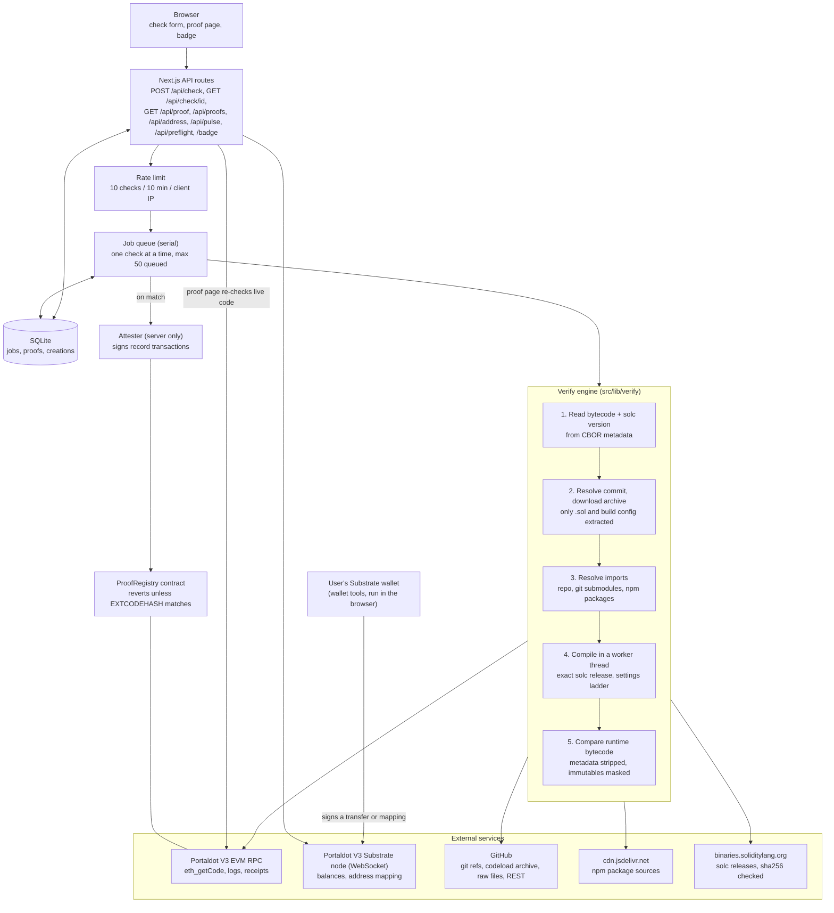

# OneScan architecture

OneScan is one Next.js process with a SQLite file. It has no indexer and no login. Every chain read is live. The public address is a Vercel front door (`deploy/vercel`) that passes every request to that one process.

## Diagram



## The same thing in plain text

```
Browser
  |
  v
Next.js API routes -- rate limit (10 / 10 min / client IP) --> Job queue (one at a time)
  |                                                              |
  |                                                              v
  |                                                        Verify engine
  |                                                          1. eth_getCode + solc version in metadata   --> Portaldot EVM RPC
  |                                                          2. resolve commit, download archive          --> GitHub
  |                                                          3. resolve imports (repo, submodules, npm)   --> GitHub raw, jsDelivr
  |                                                          4. compile in a worker thread                --> solc binaries (sha256 checked)
  |                                                          5. compare, metadata stripped, immutables masked
  |                                                              |
  |                                                    match? ---+--- no: job ends, nothing is listed
  |                                                              |
  |                                                              v yes
  |                                                        SQLite (proof stored)
  |                                                              |
  |                                          if registry + attester key are configured
  |                                                              v
  |                                                        Attester --> ProofRegistry.record()
  |                                                                    reverts unless target EXTCODEHASH == hash
  |
  +-- GET /api/proof, /badge: read the stored proof, re-read live code, compare hashes
  +-- GET /api/address: Substrate node + EVM RPC (balances, 5... <-> 0x mapping)

Wallet tools (browser): the user's own Substrate wallet signs a transfer or a mapping to the node.
OneScan never sees a key for it.
```

## What is trusted, and where

| Step | Enforced by | Strength |
| --- | --- | --- |
| Code on chain equals the compiled repo | The comparison in the verify engine | Server, but anyone can repeat it with `git`, `solc` and `eth_getCode` |
| A record points at live code | `ProofRegistry`: `target.codehash == runtimeHash`, code length above zero | Contract |
| Only OneScan can write a record | `onlyAttester` in `ProofRegistry` | Contract enforces it. Who holds the key is a trust choice |
| The record means the repo matches | The attester decided it | OneScan's attestation, not trustless |
| solc binary is the published one | sha256 from the published list, when the list carries one | Checked before use. The list comes from the same host as the binary |

## Modules

| Path | Job |
| --- | --- |
| `src/app/api/check/route.ts` | Validates input, applies the rate limit, queues a check |
| `src/app/api/check/[id]/route.ts` | Returns a job's stages and state |
| `src/app/api/proof/[address]/route.ts` | Returns a stored proof, re-checked against live code |
| `src/app/api/proofs/route.ts` | Lists matched proofs without source |
| `src/app/api/address/[address]/route.ts` | Shows both forms of an address with balances |
| `src/app/api/pulse/route.ts`, `api/preflight/[address]/route.ts` | Live site status, and a quick read of an address before a check |
| `src/app/badge/[address]/route.ts` | Draws the README badge from the live check |
| `src/app/api/_lib/` | Input normalisation, live-code comparison, rate limiter |
| `src/lib/verify/index.ts` | Runs one check and decides the verdict |
| `src/lib/verify/github.ts` | Resolves refs, downloads the archive with size and path limits |
| `src/lib/verify/imports.ts`, `graph.ts` | Finds imports, remappings, submodules, npm sources |
| `src/lib/verify/config.ts`, `pragma.ts` | Reads build settings and pragmas as text, never runs them |
| `src/lib/verify/compiler.ts` | Fetches solc, verifies its published hash, compiles in a worker |
| `src/lib/verify/metadata.ts` | Splits CBOR metadata off bytecode, compares with masking |
| `src/lib/verify/net.ts` | Fetch with timeout and retry |
| `src/lib/jobs.ts` | Serial queue, de-duplication, restart recovery |
| `src/lib/store.ts` | SQLite storage for jobs, proofs, creation info |
| `src/lib/chain.ts` | EVM RPC reads, creation lookup, activity logs |
| `src/lib/native.ts` | Substrate node reads (server only) |
| `src/lib/address.ts` | 5... and 0x address conversion |
| `src/lib/attest.ts` | Sends the record transaction (server only, holds the key) |
| `contracts/ProofRegistry.sol` | Stores a record only if it matches live code |
| `src/components/` | Pages and the wallet tools. Browser code imports types and `address.ts` only |
| `src/components/stageshow-kit/` | Third-party drawing kit for the home illustration, see `NOTICE.md` |
| `scripts/` | Make an attester key, deploy the registry (dry run by default) |
| `deploy/vercel/` | The public address: passes requests to the server and names the visitor |
